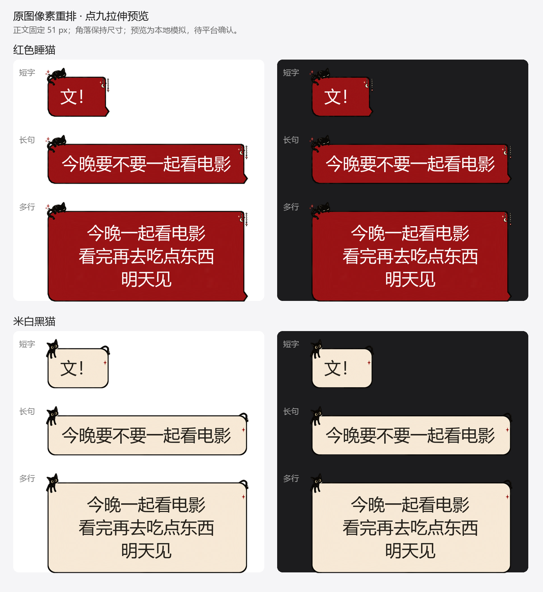

# 抖音气泡制作规范 · Douyin Chat Bubble Skill

为 AI Agent 和设计者准备的抖音 IM 聊天气泡制作流程：理解官方规范，规划正文区与点九切线，制作透明 PNG，并检查长短消息、深浅背景和图案拉伸。

**先给文字留空间，再安排角色和挂饰。**文件尺寸合规、本地预检通过、平台预览通过是三个不同状态。

> 非抖音官方项目。规范最后核验于 **2026-10-16**；以[抖音官方文档](https://effect.douyin.com/content/pwik2f7v/pwdsypki#80c5b68b)及实际编辑器为准。随包示例已完成本地预检与伸缩模拟，尚未在抖音平台实际验收。

## 下载与入口

- [下载 Skill ZIP](./dist/douyin-chat-bubble-skill.zip)
- [完整制作规范](./douyin-chat-bubble/references/制作规范.md)
- [从安装到上传的使用流程](./docs/usage.md)
- [配置 JSON 字段说明](./docs/manifest.md)
- [Agent 技能入口](./douyin-chat-bubble/SKILL.md)

## 能做什么

- 诊断尺寸、透明留白过大、装饰压字、正文底板过低等问题。
- 规划固定装饰、可伸缩背景、文字区域，提供点九与文字框坐标。
- 本地检查静态 PNG 的尺寸、大小、alpha、对比度与声明的内部留白。
- 模拟短字、长句、多行，验证四个固定角落像素保持，并生成深浅背景预览。
- 提供动态 WEBP 的规范参考；脚本本身只检查静态 PNG，不执行动态逐帧验证。

生成/编辑图像由所用 Agent 的图像工具和用户授权决定。本仓库不内置在线生图服务，也不自动上传、发布或提交抖音审核。

## 快速开始：交给 Agent

下载 ZIP，解压后把整个 `douyin-chat-bubble` 文件夹放入目标 Agent 的技能目录。Codex 常用位置是 `~/.codex/skills/douyin-chat-bubble`；其他 Agent 按自己的技能目录配置。已有同名技能时先备份，避免混入旧版本。

也可以不安装，直接让 Agent 读取克隆仓库中的 `douyin-chat-bubble/SKILL.md`。

调用示例：

```text
使用 $douyin-chat-bubble 调整附件中的抖音聊天气泡。
保留原图猫咪姿态、挂饰和配色，缩小装饰，给文字留出空间。
交付透明 PNG、文字颜色、点九切线和文字框坐标、长短消息及深浅背景预览。
请把本地检查结果与平台实际验证状态分别说明。
```

## 快速开始：运行检查脚本

需要 **Python 3.10+** 和 Pillow。普通格式/对比度检查不需要字体；生成含中文的预览时需要本机中文 TTF/TTC 字体，仓库不分发字体。

```bash
git clone https://github.com/kemakiko9566-design/-.git douyin-chat-bubble-skill
cd douyin-chat-bubble-skill
python -m pip install -r requirements.txt

# 检查随包两张示例，不生成文字预览
python douyin-chat-bubble/scripts/bubble_check.py douyin-chat-bubble/assets/example.json --out checks
```

Windows 含字预览：

```powershell
python douyin-chat-bubble/scripts/bubble_check.py douyin-chat-bubble/assets/example.json --out checks --font C:/Windows/Fonts/msyh.ttc
```

macOS/Linux 把 `--font` 换成本机实际中文字体路径。输出包括 `checks/preflight.json`，提供字体后还会生成 `red_preview.png` 和 `cream_preview.png`。

退出码 `0` 表示本地硬检查通过；`1` 表示发现错误。**还需阅读 warnings，并在抖音编辑器设置切线、文字框后预览。**本地预检不是平台审核结果。

## 完整使用流程

1. **确认输入**：核对确切上传文件、静态/动态类型，以及用户要保留原像素还是整体风格。
2. **规划正文**：依据固定 51 px 正文、72×72 px 参考保护区及内边距安排底板，再放装饰。
3. **安排伸缩**：装饰留在固定区域，平整背景和连续边框负责伸缩；避免细节和密集颗粒跨入切线。
4. **导出配置**：保存 PNG 和 JSON，分别记录四条切线、文字框、保护区、正文颜色和主体底板范围。
5. **本地验证**：运行脚本，查看短字、长句、多行和深浅背景，修复压字、变形、条纹、接缝等问题。
6. **平台验证**：上传 PNG，分别拖动点九切线和文字框、设置文字颜色，再查看平台预览。经用户授权后才提交审核或发布。

逐步说明、替换自己的素材和故障定位见[使用流程](./docs/usage.md)。

## 核心规则速览

| 项目 | 当前规则/参考 |
|---|---|
| 静态文件 | 一张主态 PNG，≤198×162 px，宽高均可被 3 整除，≤2M |
| 正文 | 固定 51 px；72×72 px 为保护区参考 |
| 文本内边距 | 左右 >24 px，上下 >18 px |
| 对比度 | 正文与背景 ≥4.5:1 |
| 实体高度 | 120 px 为设计起点，一般不超过 135 px，并非统一硬模板 |
| 装饰间距 | 文档上下 ≤36 px、左右 ≤42 px；实际报错出现 40 px，脚本保守取 40 |
| 点九切线 | 编辑器可拖动，不能把报错的三分位置采样当成固定三等分切线 |

出处、规则性质与单位解释见[完整规范](./douyin-chat-bubble/references/制作规范.md)，不要将示例坐标直接套在其他素材上。

## 示例与验证边界



猫咪和挂饰来自原图拆层与等比缩放；底板轮廓重新组织、纹理对比被弱化，以减少拉伸条纹。它不是整张原图的无损转换。示例图用于说明制作与检查过程，不是所有气泡的统一视觉模板。

示例可上传 PNG：[`red.png`](./douyin-chat-bubble/assets/red.png)、[`cream.png`](./douyin-chat-bubble/assets/cream.png)。设置坐标见[平台设置](./本次示例_平台设置.md)，本地结果见[检查报告](./本次示例_检查结果.json)。

脚本中的透明扫描参考本任务报错做保守预检，并非抖音内部算法。对比度覆盖声明的文字框；装饰是否被错误放入伸缩带、纹理是否好看、实际行高与平台排版仍需人工及平台预览。

## 仓库结构

```text
README.md
docs/                         使用流程与 JSON 字段
douyin-chat-bubble/
  SKILL.md                    Agent 入口
  agents/openai.yaml          技能展示信息
  references/制作规范.md       完整规则与来源
  scripts/bubble_check.py     静态检查与点九预览
  assets/                     两张示例和配置
dist/                         可直接下载的 Skill ZIP
```

## 维护

修改规范时保留核验日期、来源和“官方要求/设计参考/本地经验”的区别。修改脚本或示例后运行快速检查，并实际查看重新生成的预览。仓库内不放 API Key、账号凭据、私人路径或与气泡无关的工作区文件。
